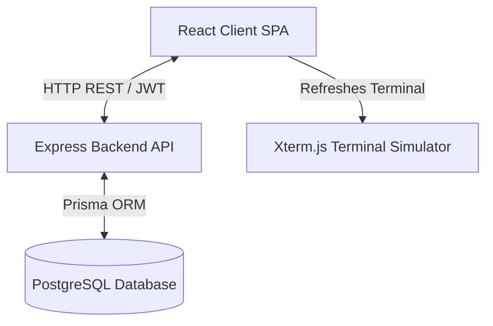

# System Architecture & Technical Design

This document details the system design, communication protocols, and simulation logic of the Cyber Academy application.

---

## 🏗️ High-Level Architecture

The platform follows a standard client-server decoupled architecture:



- **Frontend Client**: Single Page Application built with React 19, Vite, and Tailwind CSS. It manages the virtual workspace dashboard, onboarding flows, and the floating draggable window manager.
- **Backend API**: Stateless REST API built with Express.js. It handles user authentication, JWT signing/verifying, and completed progress updates.
- **Database Layer**: PostgreSQL manages persistence for user accounts and completed lesson milestones via the Prisma ORM.

---

## 💻 Terminal Simulator Mechanics

Rather than spawning actual virtual machines (which can be resource-intensive and represent a security risk), the terminal uses an **in-memory simulation engine** inside [Terminal.tsx](file:///d:/Dev/Cyber-academy/src/components/Terminal/Terminal.tsx).

### Flow of Command Execution
1. **User Input**: Input is captured character-by-character using the `@xterm/xterm` library's `onData` listener.
2. **Parsing**: When `Enter` is hit, the raw string is parsed into command name and arguments.
3. **Execution Routing**:
   - Standard shell commands (`ls`, `cd`, `cat`, `grep`, `strings`, `pwd`, `whoami`) query a mock file system configured dynamically depending on the current loaded `activeLesson.id`.
   - Special tools (`nmap`, `hashcat`, `curl`, `nslookup`, `sqlmap`, `hydra`, `./vulnerable_binary`) evaluate arguments. If the arguments match the expected target values for that specific lesson, the simulation writes mock success logs and dumps the flag.
   - Unauthorized tool calls are blocked dynamically with helper context warnings if the operator attempts to use a tool that is not unlocked or scoped for the active lesson.

---

## 📊 Database Schema & Progress Tracking

The PostgreSQL database maintains two core states: user profiles (credentials, levels, XP) and lesson progress.

```prisma
model User {
  id             String    @id @default(uuid())
  username       String    @unique
  email          String    @unique
  passwordHash   String
  xp             Int       @default(0)
  level          Int       @default(1)
  progress       Progress[]
}

model Progress {
  id             String    @id @default(uuid())
  userId         String
  lessonId       String
  completed      Boolean   @default(false)
  completedAt    DateTime?
  user           User      @relation(fields: [userId], references: [id])
}
```

- **Progress Sync**: When a user submits a valid flag, the client triggers `completeLesson(lessonId)`. The backend registers a new `Progress` row for that user, computes new XP (+100 XP), calculates if the user levels up (each level requires 500 XP), updates the `User` database record, and returns the updated user profile back to the frontend.

---

## 🔑 Authentication & Session Management

- **JWT Tokens**: Login/Register operations return a JSON Web Token (JWT) signed with the backend's `JWT_SECRET`.
- **LocalStorage Sync**: The JWT is persisted on the client's local storage and injected as an `Authorization: Bearer <token>` header in all Axios API calls.
- **Zustand Auth Store**: Manages auth states globally. On page loads, it fetches the current progress list to compute completed checkmarks in the sidebar.
